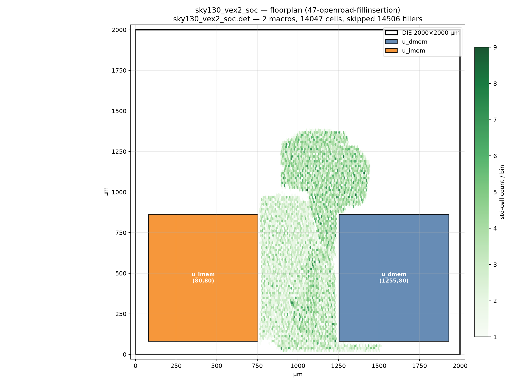
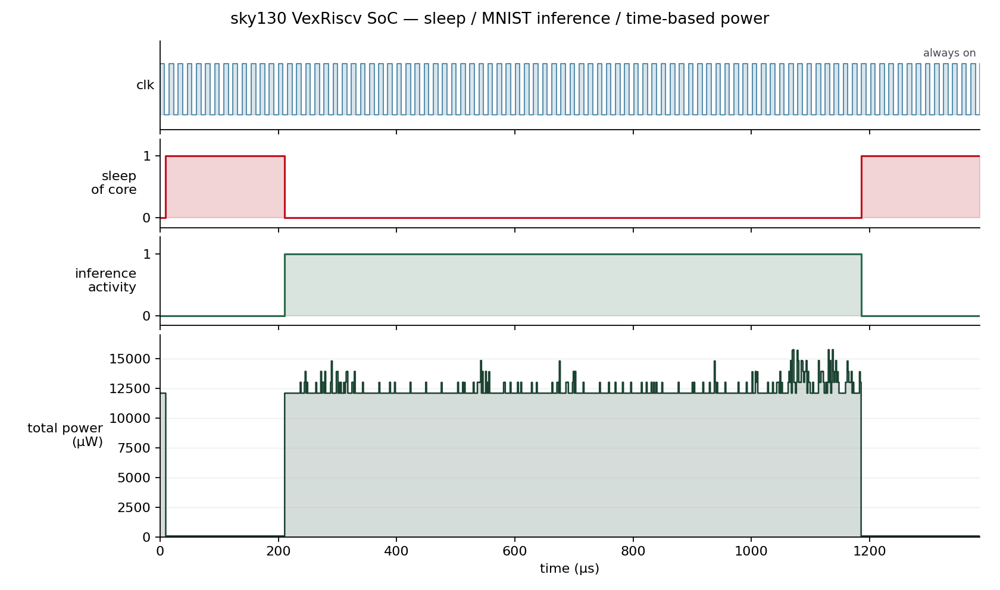
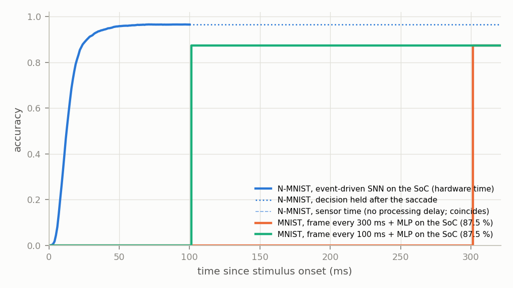

# sky130 VexRiscv + SRAM22 SoC — time-based power

Open-source path toward a tapeout-oriented RISC-V design on SkyWater 130 nm:
**VexRiscv** (four-stage pipeline) + **two SRAM22 macros**, with **clock-gated sleep** and
**windowed OpenSTA power** from a gate-level VCD.

<p align="center">
  
</p>

<p align="center"><em>Post-PnR floorplan — IMEM / DMEM macros + standard-cell logic</em></p>

<p align="center">
  
</p>

<p align="center"><em>Always-on <code>clk</code>, core sleep, MNIST inference, and total power (µW) vs time</em></p>

## Results (checked-in snapshot)

GLS VCD → OpenSTA activity power at **50 MHz** (TT 1.8 V), plus post-PnR area.
Raw files under [`docs/results/`](docs/results/).

### Average power / energy (one MNIST inference run)

| Metric | Value |
|--------|--------|
| Blended average power | **9.12 mW** |
| Awake / sleep power | 12.75 mW / **0.19 mW** |
| Core clock-enable duty | 0.711 |
| Energy / inference | **12.65 µJ** |
| Runtime @ 50 MHz | 1.39 ms (69 328 cycles) |

Group breakdown (blended): clock 44.8%, sequential 38.4%, macro 11.9%, combo 4.9%.

### Time-windowed power (N = 1000)

| Metric | Value |
|--------|--------|
| Window-average total | 8.83 mW |
| Peak window / min window | 15.78 mW / **0.076 mW** |

### Area / timing

| Metric | Value |
|--------|--------|
| Consumed area (cells + macros) | **1.422 mm²** |
| Stdcells / SRAM macros | 0.367 / 1.055 mm² |
| Die outline (floorplan) | 4.000 mm² |
| Clock / implied Fmax | 50 MHz target / **53.0 MHz** (setup+hold MET) |

### Event-driven N-MNIST workload (asynchronous inference, one event at a time)

A second workload ([`firmware/nmnist/`](firmware/nmnist/)): a spiking classifier for the N-MNIST event stream
that is trained and executed **event by event, without a time step or a leak tick**. The core wakes for every
input event, updates 32 integrate-and-fire neurons and 10 output integrators, checks the decision (argmax with a
margin) and sleeps again; the testbench replays the sample's event times and records the decision edge.
Same 8x8 input resolution and hidden size as the MNIST MLP above.

| Metric | Value |
|--------|--------|
| Network | 128 (8x8x2 pooled events) → 32 IF → 10, int8 weights, no leak, first saccade (100 ms) |
| Test accuracy (exact per-event reference, 10 000 samples) | **96.51 %** |
| Decision accuracy / median latency at margin 256 | 94.3 % / **26.9 ms** after stimulus onset |
| Awake cycles per event (`-O3`, 50 MHz) | 917 mean (18.3 µs), 1222 max |
| Energy per event / to the decision / per sample | 233.8 nJ / **51.52 µJ** / 420.65 µJ |
| Average power at the sample's real-time event rate | 4.228 mW (awake duty 32.2 %) |

Raw files: `docs/results/nmnist_*.txt`; method in [`firmware/nmnist/README.md`](firmware/nmnist/README.md) and
[`power/README.md`](power/README.md). Reproduce with `./power/measure_nmnist.sh`.
The awake power comes from the same global-activity OpenSTA model as the MNIST numbers above (12.75 mW awake,
0.19 mW asleep), so the energies scale with awake cycles and duty; cycle counts and latency are exact (RTL and
SDF gate-level simulation agree, bit-exact with the Python reference). The MNIST MLP inference costs 12.65 µJ;
the event-driven classifier spends 4x that to its decision and 33x over the whole 100 ms stimulus, because every
event updates all 32 neurons in software (about 56,000 neuron updates against 2,400 multiply-accumulates).

<p align="center">
  
</p>

<p align="center"><em>Accuracy versus real hardware time since stimulus onset: event-driven N-MNIST on the SoC against the
frame-based MNIST MLP (frame period + 1.39 ms inference)</em></p>

Latency in hardware time ([`firmware/nmnist/hw_latency.py`](firmware/nmnist/hw_latency.py), all 10,000 test samples,
cost model calibrated on the RTL event log: 901 + 70 cycles per hidden spike, queue of the testbench): the event-driven
classifier is at 81 % accuracy 20 ms after stimulus onset, 92 % at 30 ms and 96 % at 50 ms, and its margin decision
comes at a median of 26.9 ms; the processing backlog adds 0.02 ms to the median. A frame-based pipeline cannot answer
before the frame is complete: 301 ms with a 300 ms frame period, 101 ms with a 100 ms one. The SoC keeps up with the
stream at 50 MHz: 27 % awake duty on average, 55 % for the busiest sample, worst backlog 3.4 ms, and the mean event rate
would be sustained down to a 13.5 MHz clock. (The MLP's 87.5 % is the accuracy of this repository's 3-epoch 8x8 demo
network; the comparison is about time, not about the two accuracies.)

## Locked choices

| Block | Choice | Notes |
|-------|--------|--------|
| Core | `VexRiscv2` (decode/execute/memory/writeback, bypass, mul/div) | Generated from SpinalHDL; timing-oriented for a 60 MHz target |
| IMEM | `sram22_2048x32m8w8` | 2048 × 32 = **8 KiB** |
| DMEM | `sram22_2048x32m8w8` | same |

## Memory map

| Region | Address | Size |
|--------|---------|------|
| IMEM (fetch only) | `0x0000_0000` – `0x0000_1FFF` | 8 KiB |
| DMEM | `0x1000_0000` – `0x1000_1FFF` | 8 KiB |
| tohost | `0x2000_0000` | write nonzero → `halted`, core clocks gated |
| gpio | `0x2000_0004` | bit0 `done` handshake to TB |
| sleep | `0x2000_0008` | write 1 → clock-gate sleep until `wake` |
| status | `0x2000_000C` | bit0 `sleeping` (RO) |
| wake | pin | TB rising edge wakes core + pulses `externalInterrupt` |

Firmware schedule (MNIST TB): init → **sleep** → wake → **inference** → **sleep** → halt.

## Repository layout

```
setup/          install PDK, Nix, OpenLane, toolchains
rtl/            CPU, sleep/ICG, SoC bridges, SRAM behavioral link
firmware/       bare-metal MNIST MLP (+ sleep/wake handshake)
simulation/     Icarus RTL + gate-level sims + VCD waveforms
synthesis/      OpenLane config + run_synthesis.sh
power/          average + time-windowed OpenSTA power from VCD
docs/figures/   floorplan + power-timeline plots
docs/results/   average power, time-power, area/timing snapshots
third_party/    VexRiscv, sram22_sky130_macros (fetch via setup/)
```

## Quick start — time-based power

```bash
# Tools + PDK (once)
cd setup && ./install_nix.sh && ./install_pdk.sh && ./install_openlane.sh
./install_oss_cad_suite.sh && ./install_riscv_toolchain.sh && ./fetch_third_party.sh
cd ..
source env.sh

# 1) Synthesize (CLOCK_PERIOD in synthesis/sky130_vex2_soc/config.yaml)
./synthesis/run_synthesis.sh

# 2) Gate-level sim with SDF → activity VCD
./simulation/run_gls.sh fw --vcd          # → simulation/waveform_gls.vcd

# 3) Windowed power timeline (default N=1000 equal slots)
./power/run_time_power.sh ./simulation/waveform_gls.vcd
# → power/out_waveform_gls_time/power_vs_time.vcd|.csv

# 4) Refresh the README figure (optional)
python3 power/plot_power_timeline.py
```

Average energy for the whole run (same activity model):

```bash
./power/run_avg_power.sh ./simulation/waveform_gls.vcd
```

RTL bring-up (no power accuracy):

```bash
./simulation/run_sim.sh fw --vcd
```

Each of `setup/`, `simulation/`, `synthesis/`, `power/`, and `firmware/` has its own README.

## Shared paths

| Path | Purpose |
|------|---------|
| `/media/pdk` | `PDK_ROOT` (sky130A via volare) |
| `/media/hardware_design_tools` | OpenLane, OSS CAD Suite, volare venv |

```bash
source env.sh
```
